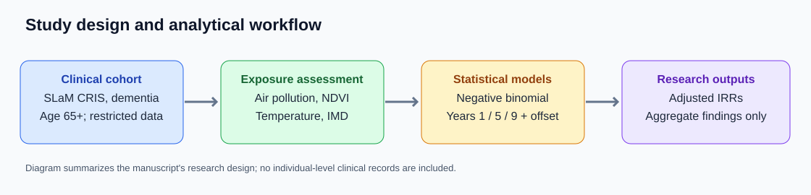
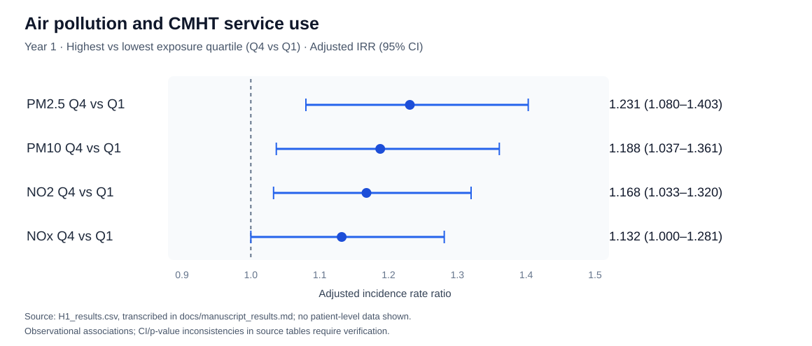

# Environmental Exposures & Mental Health Service Utilisation in Dementia

**Longitudinal environmental epidemiology | Negative-binomial regression | Health services research | R**

An applied research project investigating how **air pollution, residential greenness, temperature and neighbourhood deprivation** relate to **Community Mental Health Team (CMHT) service use** among older adults living with dementia in South London.

> **Research outcome:** Our regression analyses show higher CMHT utilisation in the highest pollutant quartiles versus the lowest, positive associations with IMD, and model-dependent NDVI and temperature associations. These are observational findings, not causal effects.



## Project at a glance

| | |
|---|---|
| **Research setting** | South London and Maudsley NHS Foundation Trust (SLaM); Clinical Record Interactive Search (CRIS) |
| **Study population** | Adults aged 65+ with recorded dementia |
| **Reported primary cohort** | **5,007 participants** (see sample-definition note below) |
| **Follow-up** | Year 1, Year 5 and Year 9 |
| **Outcome** | CMHT event counts, adjusted for time under observation |
| **Methods** | Negative-binomial regression, nested adjustment specifications, exposure interactions, missing-data and sensitivity analysis |
| **Technical tools** | R, `MASS::glm.nb`, robust covariance estimation, reproducible analytical workflows |

## Key findings



*Forest plot: Year 1 Q4 versus Q1 pollutant comparisons, based on the H1 aggregate regression results. Confidence intervals reflect the archived analysis results; interpretation notes are documented separately.*


The following are **adjusted IRRs from the study's archived regression results** (original clinical records are no longer accessible for reanalysis). Results differ across adjustment specifications.

| Exposure / model | Year 1 | Year 5 | Year 9 |
|---|---:|---:|---:|
| PM₂.₅ Q4 vs Q1 (H1) | **1.231** | **1.200** | **1.201** |
| PM₁₀ Q4 vs Q1 (H1) | **1.188** | **1.218** | **1.231** |
| NO₂ Q4 vs Q1 (H1) | **1.168** | **1.313** | **1.322** |
| NOₓ Q4 vs Q1 (H1) | **1.132** | **1.289** | **1.298** |
| NDVI (H3 output; PM₂.₅ model) | **0.442** | **0.381** | **0.403** |
| Temperature (H3 output; PM₂.₅ model) | **1.019** | **1.020** | **1.021** |
| IMD per point (H4 output; PM₂.₅ model) | **1.0096** | **1.0068** | **1.0068** |
| NDVI (H4 fuller adjustment; PM₂.₅ model) | **0.995** | **0.921** | **0.996** |

The fuller H4 adjustment substantially attenuates the NDVI association; the available interaction outputs do not support a consistent overall effect-modification claim. See [detailed findings](docs/manuscript_results.md) and the [aggregate-results quality audit](docs/results_quality_audit.md) for model-specific estimates, interpretation limits and model-comparison notes.

**Outcome:** CMHT service utilisation among people already diagnosed with dementia, not dementia incidence.

[Read the detailed manuscript findings](docs/manuscript_results.md)

## What the project demonstrates

- **Longitudinal observational analysis:** specified service-use count outcomes at three follow-up horizons and incorporated `log(observed days)` offsets to account for differing exposure time.
- **Multivariable statistical modelling:** assessed pollution, greenness, temperature and socioeconomic deprivation through staged negative-binomial models.
- **Effect-modification analysis:** considered interactions between air pollution and NDVI, temperature and deprivation, while avoiding overinterpretation of statistically inconclusive interactions.
- **Missing-data methodology:** documented complete-case and multiple-imputation approaches, with sensitivity checks requiring reconciliation against the approved manuscript.
- **Reproducibility and research governance:** structured a public R workflow while keeping patient-level NHS clinical records in access-controlled systems.

## Analytical approach

**Outcome:** number of CMHT service-use events.

**Model family:** negative-binomial generalized linear models with a log link and an observation-time offset:

```r
MASS::glm.nb(cmht_events ~ exposure + covariates +
             offset(log(active_observation_days)), data = secure_data)
```

The analysis considered four nested adjustment specifications, moving from entry timing to environmental and demographic/geographic/socioeconomic covariates. Separate analyses considered **Years 1, 5 and 9** and exposure interactions. See [analysis plan](docs/analysis_plan.md) for the working specifications.

## Code and reproducibility

This repository documents a **completed empirical analysis** through available manuscript results and a public-facing R workflow. The original patient-level CRIS extract is **encrypted and not accessible for a new analysis run**. Consequently, the public code is presented as an analytical reference and synthetic-data demonstration, **not as an independently verified reproduction** of the study estimates. Re-running the restricted models is not a requirement for understanding or evaluating the documented research.

| Location | Contents |
|---|---|
| [`R/`](R/) | Cohort checks, negative-binomial model engine, interactions, diagnostics and secure pipeline |
| [`docs/manuscript_results.md`](docs/manuscript_results.md) | Detailed findings and verification limits |
| [`docs/analysis_plan.md`](docs/analysis_plan.md) | Research design and model specifications |
| [`docs/results_quality_audit.md`](docs/results_quality_audit.md) | Cross-model interpretation and statistical consistency checks |
| [`docs/research_notes.md`](docs/research_notes.md) | Research interpretation and reporting conventions |
| [`docs/data_dictionary.md`](docs/data_dictionary.md) | Working variable definitions |
| [`docs/secure_execution.md`](docs/secure_execution.md) | Restricted-data execution and disclosure guidance |
| [`tests/`](tests/) | Synthetic-data tests; no clinical records |
| [`.github/workflows/`](.github/workflows/) | Automated synthetic test workflow |

## Data availability and privacy

**Individual-level SLaM CRIS data are confidential, encrypted and unavailable to this repository's maintainers for reanalysis.** Researchers seeking independent access must contact the relevant **SLaM/CRIS data governance or research access authorities** and obtain applicable institutional approvals; access is not guaranteed. This repository does not distribute patient records, linkage identifiers, restricted extracts or model objects containing sensitive information.

Only disclosure-cleared aggregate findings are suitable for public presentation. The aggregate research results are documented here without exposing confidential underlying records.

## Study status and reporting notes

- **Research findings exist in a dissertation/manuscript.** This repository is not merely a proposal or an empty modelling scaffold.
- **Publication status:** described as an unpublished manuscript; peer-reviewed publication has not been verified.
- **Sample definitions:** the main manuscript reports **N = 5,007**, while a separate supplementary-methods description lists **5,024 complete cases** and **5,272 participants in an imputation sample**. These figures may refer to different analysis populations and must be reconciled before making claims about a single universal analytic N.
- **Numerical precision:** the key findings table reflects archived H1/H3/H4 model results; unresolved inconsistencies and interaction-test limitations are documented in the detailed results.

For research interpretation, refer to the [detailed results](docs/manuscript_results.md). For reproducibility limitations, see [secure execution](docs/secure_execution.md).
